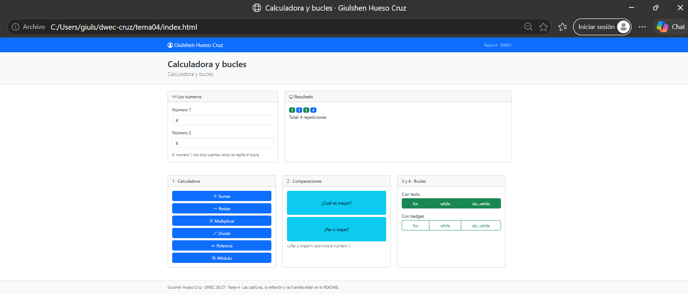
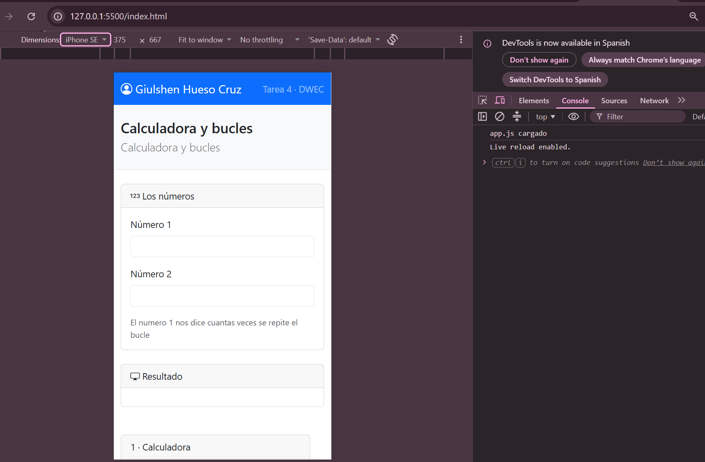
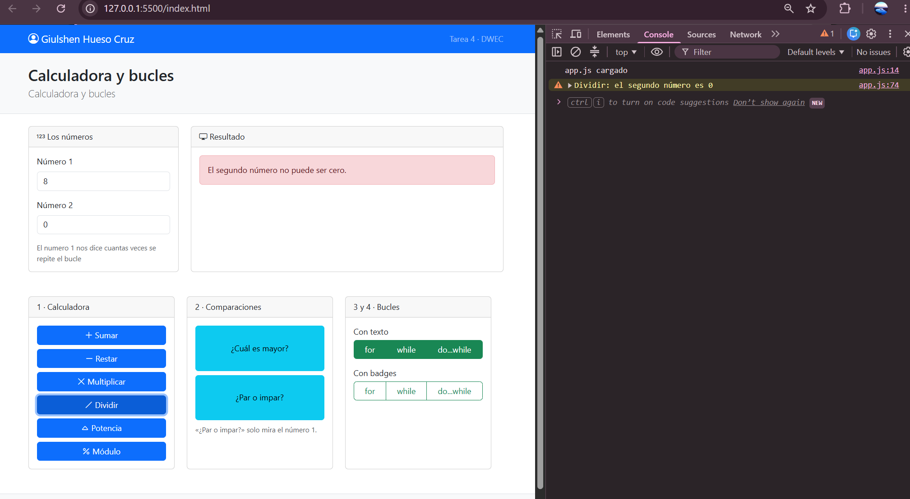
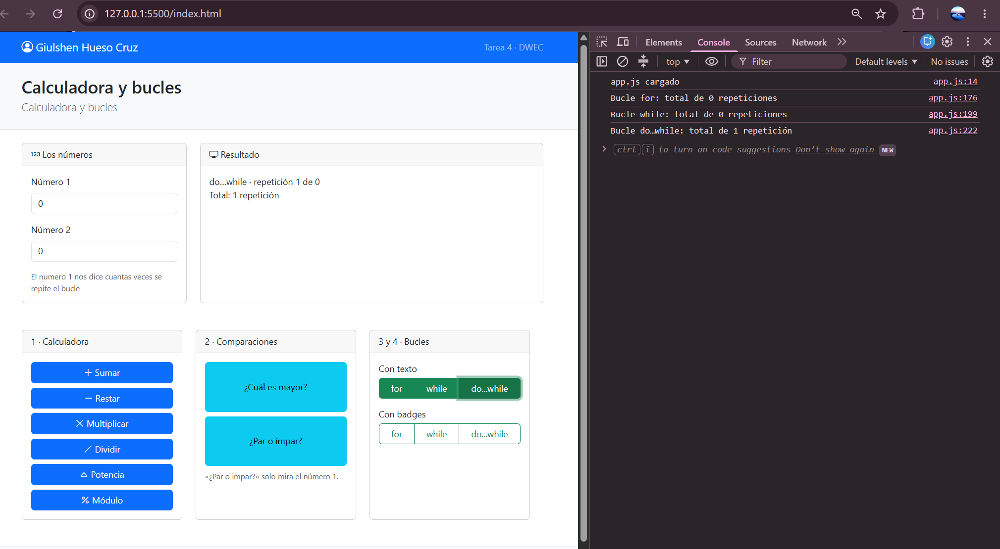
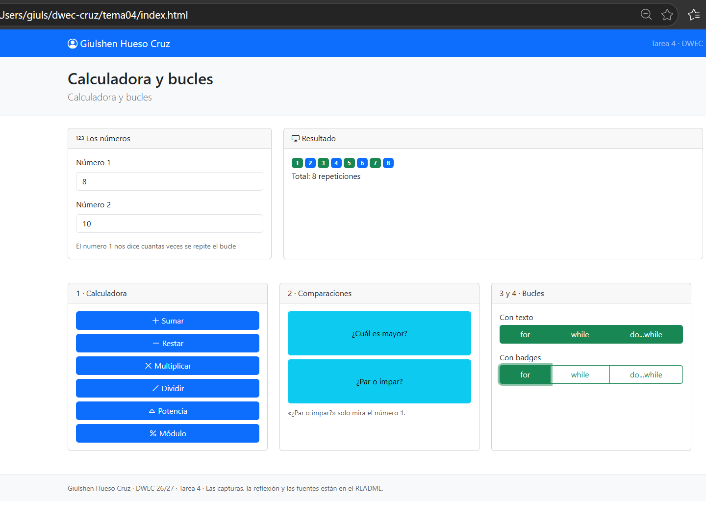

# Tarea 4 · Calculadora y bucles

**Autor:** Giulshen Hueso Cruz · Desarrollo Web en Entorno Cliente (DWEC) · 2.º DAW · Curso 2026-27

## Capturas

### a) La página entera

[Qué se ve: tu nombre en la navbar y cómo has repartido las cards con la rejilla.]

### b) La página en el móvil

[Qué cambia respecto a la pantalla grande.]

### c) El error de dividir entre 0

[Qué se ve en la página y en la consola.]

### d) Los tres bucles con el número 0

[Cuántas veces se repite cada bucle y por qué.]

### e) Un bucle con badges

Verde para los números impares y azul para los que son pares.
Yo he puesto el 8 para 8 repeticiones.

## Reflexión

Hay varias formas en Javascript de que se repitan instrucciones. Los bucles, en mi opinión son útiles como el "for", para saber cuantas veces quiero que algo se repita. El while sabemos todos que sirve para repetir las instrucciones mientras se cumpla una condición,en cambio, el do while, se ejecuta al menos una vez, aunque la condición no se llegue a cumplir. Por ejemplo, si yo tengo 0 los bucles for el while no se van a ejecutar, pero el do while sí.
Aparte, he de decir, en mi caso, que yo no sabía lo que eran los badges y lo he aprendido en este ejercicio/tema. 

## Fuentes
He puesto Boostrasp y Boostrap Icons.

## Uso de IA

Todas las correciones se han realizado con claude, en concreto porque tenía varios DIV sin cerrar y por lo tanto la página no me salía en horizontal en el navegador, por lo que le saltará la ia, por haber copiado las soluciones de los errores, pero los ejercicios los he realizado yo en visual studio code. 
No hay enlaces esta vez, ya que no he consultado nada en internet, porque venía todo lo que necesitaba en la plantilla, lo único que he hecho ha sido repasar javascript en una pagina llaada w3shool para comprender mejor el funcionamiento de javascript.
https://www.w3schools.com/
https://getbootstrap.com/docs/5.3/getting-started/introduction/ 
https://icons.getbootstrap.com/