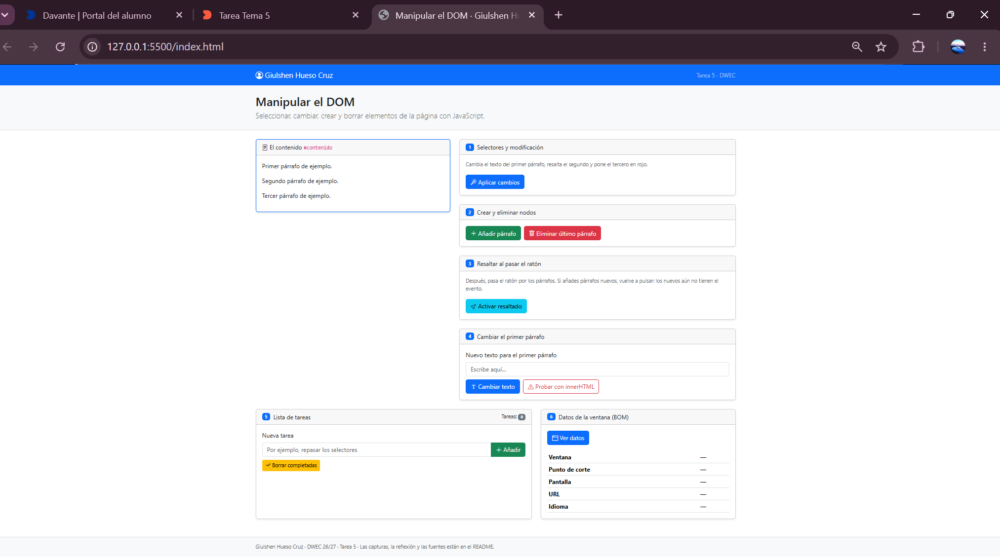
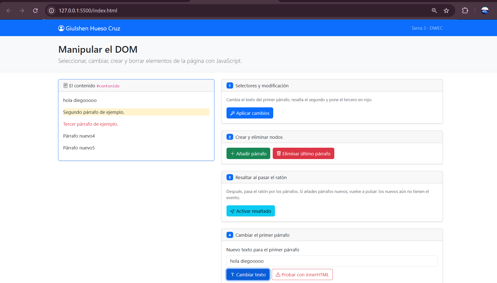
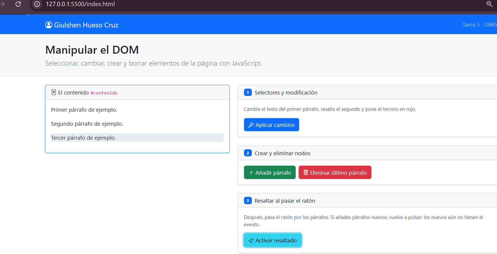
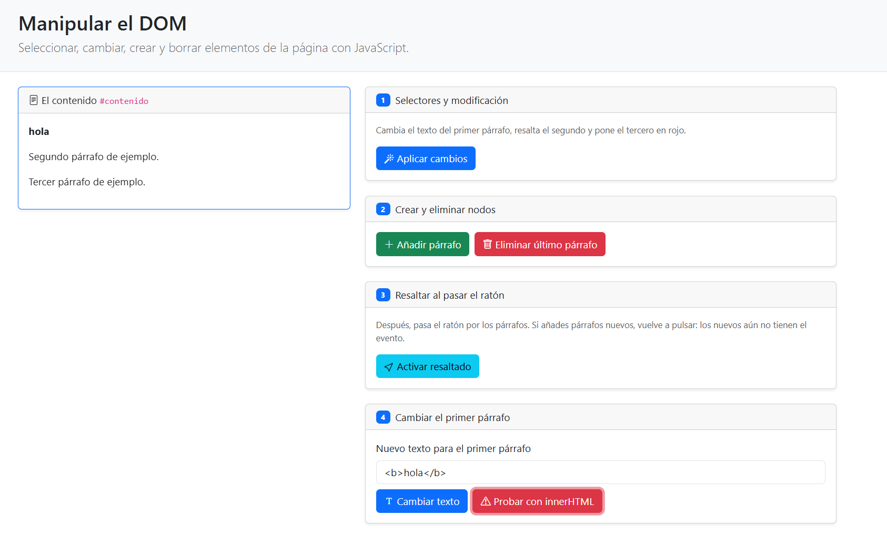
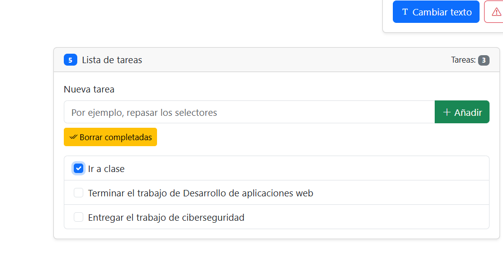
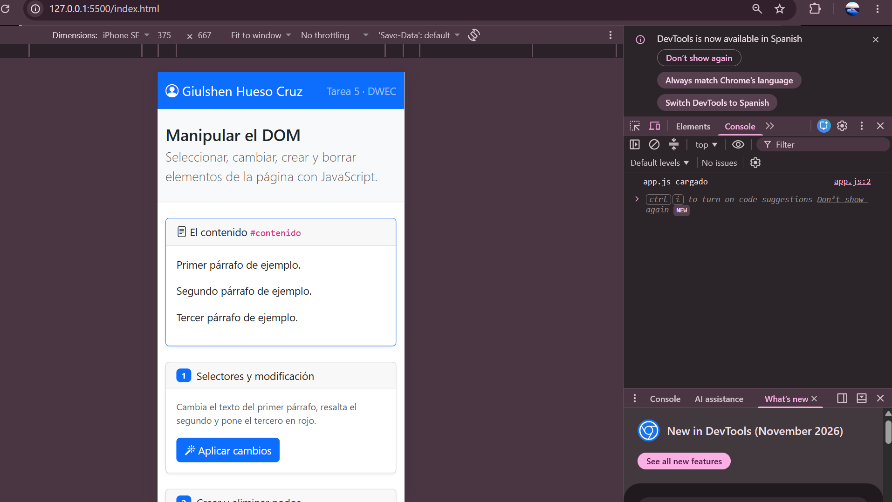

# Tarea 5 · Manipular el DOM

**Autor:** Giulshen Hueso Cruz · Desarrollo Web en Entorno Cliente (DWEC) · 2.º DAW · Curso 2026-27

Esta carpeta contiene una página con Bootstrap 5 (`index.html`) y su JavaScript (`js/app.js`), donde cada botón ejecuta una función que manipula el DOM: seleccionar y modificar elementos, crear y borrar nodos, eventos de ratón, `textContent` frente a `innerHTML`, una lista de tareas y los datos de la ventana (BOM). Para probarla, abro la carpeta en VS Code, pulso **Go Live** y uso los botones con la consola abierta (F12), donde cada función escribe un mensaje.

## Capturas

### a) La página recién cargada

Se ve mi nombre y los tres párrafos de partida.

### b) Ejercicios 1 y 2

Con «Aplicar cambios» (ejercicio 1):

- El primer párrafo cambia su texto a «Texto modificado por JavaScript». Lo selecciono con `getElementById("primero")` y uso `textContent`.
- El segundo párrafo se resalta con la clase `bg-warning-subtle`. Lo selecciono con `querySelector(".segundo")`.
- El tercer párrafo se pone en rojo con `text-danger`. Lo selecciono con `querySelectorAll("#contenido p")[2]`.

Con «Añadir párrafo» (ejercicio 2) creo cada párrafo nuevo con `createElement("p")` y lo inserto con `append()`. Al pulsarlo dos veces aparecen «Párrafo nuevo4» y «Párrafo nuevo5» al final del contenido.

### c) Ejercicio 3: resaltado al pasar el ratón

El párrafo que tiene el ratón encima se resalta con `bg-body-secondary` (evento `mouseenter`) y vuelve a la normalidad al salir (evento `mouseleave`). Los párrafos que añado después no se resaltan hasta que vuelvo a pulsar «Activar resaltado», porque el evento solo se asigna a los párrafos que existen en ese momento.

### d) Ejercicio 4: `<b>hola</b>` con innerHTML

Con «Cambiar texto» (`textContent`) el párrafo muestra literalmente `<b>hola</b>`, etiquetas incluidas. Con «Probar con innerHTML» el navegador interpreta la etiqueta y muestra **hola** en negrita.

### e) Ejercicio 5: la lista de tareas

La lista tiene tres tareas, una de ellas marcada, antes de pulsar «Borrar completadas». El contador de la cabecera muestra 3.

### f) Ejercicio 6: los datos de la ventana en el móvil

En el modo móvil sale el punto de corte **xs** (menos de 576 px). En mi ordenador sale **[lg / xl / xxl: pon el que te salga a ti]**, porque la ventana es mucho más ancha.

## Reflexión

`textContent` inserta lo que le pasas como texto plano, así que si escribo `<b>hola</b>` se ve tal cual, con las etiquetas. `innerHTML`, en cambio, interpreta ese texto como HTML, y por eso en la prueba apareció «hola» en negrita. Eso es un problema cuando el texto lo escribe el usuario: si alguien introduce algo como ``, el navegador creará ese elemento y ejecutará el código malicioso (un ataque XSS). Por eso, para mostrar texto que viene del usuario, se usa `textContent`, y `innerHTML` solo se usa con contenido que controlo yo.

## Fuentes

- [Node.textContent – MDN](https://developer.mozilla.org/es/docs/Web/API/Node/textContent)
- [Element.innerHTML – MDN](https://developer.mozilla.org/es/docs/Web/API/Element/innerHTML)
- [Breakpoints – Bootstrap 5.3](https://getbootstrap.com/docs/5.3/layout/breakpoints/)

## Uso de IA

He usado Claude pra hacer el readme y para coo¡rregir los ejercicios 4, 5 y 6 que tenían algún fallo porque no he sabido hacerlos por mi cuenta del todo ni mirando los auntes, ya que el value.trim no me funcionaba bien. Por último me ha ayudado para poner bien las dimensiones de la ventana de Boostrap.