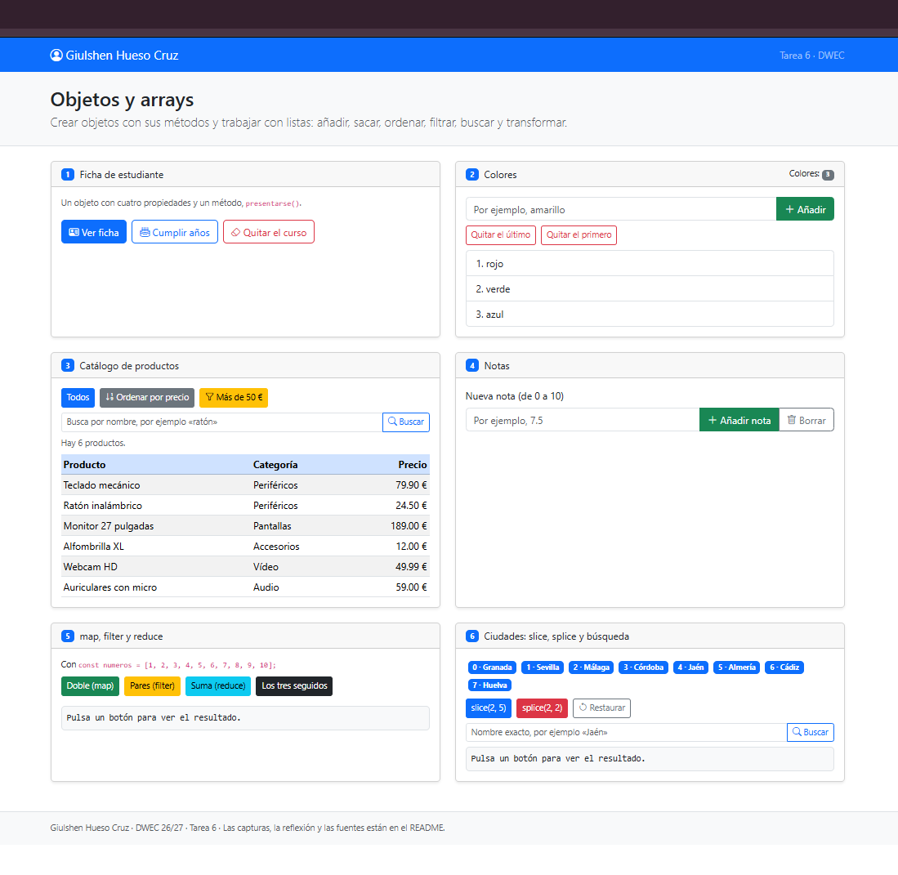
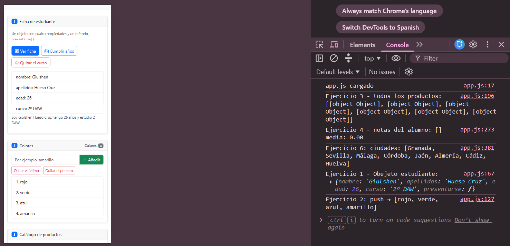
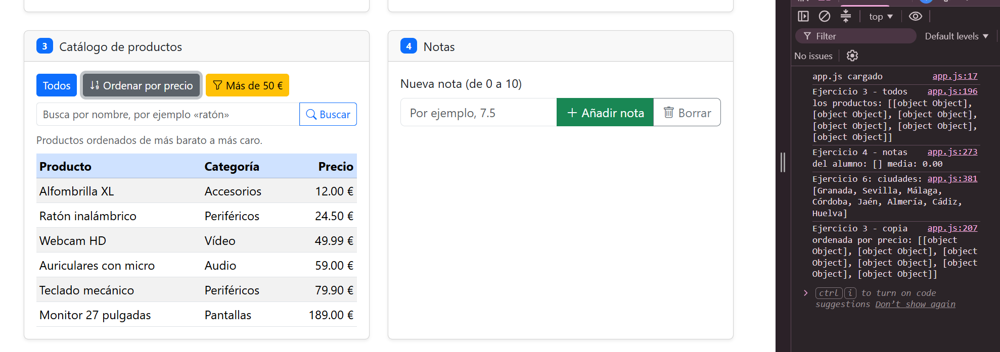
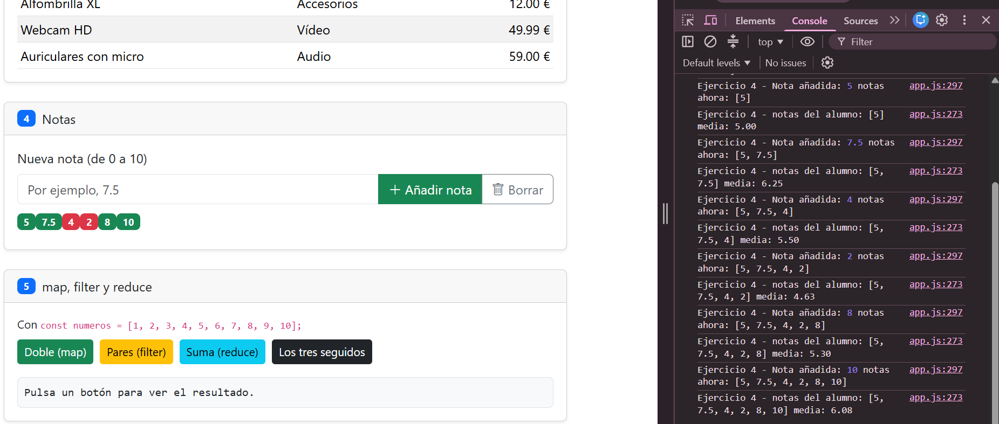
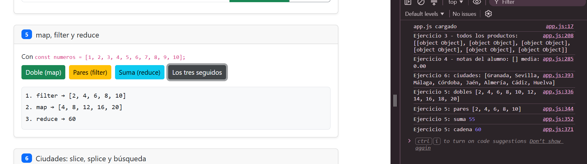
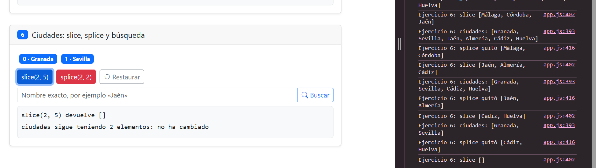

# Tarea 6 · Objetos y arrays

**Autora:** Giulshen Hueso Cruz · Desarrollo Web en Entorno Cliente (DWEC) · 2.º DAW · Curso 2026-27

En esta carpeta está mi trabajo de la Tarea 6, en el que he realizado seis ejercicios relacionados con los objetos y los arrays en JavaScript.

Para hacer la página he utilizado Bootstrap para darle un poco de estilo y he incluido todo el código JavaScript en el archivo `js/app.js`. En esta práctica he trabajado utilizando funciones tradicionales con `function`, sin utilizar funciones flecha.

Para abrir y probar la página, solo hay que abrir el proyecto en Visual Studio Code, iniciar **Go Live** y pulsar los diferentes botones. Es recomendable tener abierta la consola del navegador (F12) para poder ver los resultados.

## Capturas

### a) Página principal al cargar

Al abrir la página, lo primero que aparece es la interfaz con mi nombre en la barra de navegación, las tarjetas de los ejercicios, la tabla con los productos y la lista de ciudades. En este momento todavía no he pulsado ningún botón, por lo que aparecen los datos iniciales.

### b) Ejercicios 1 y 2: objeto de estudiante y lista de colores

En el primer ejercicio he creado un objeto con los datos de un estudiante y sus diferentes propiedades. Después he modificado su edad para comprobar cómo se puede cambiar directamente una propiedad de un objeto utilizando la notación de punto.

En el segundo ejercicio he trabajado con un array de colores. He utilizado métodos como `push()` para añadir elementos y `pop()` para eliminar el último. De esta manera he podido ver cómo cambia la lista al modificar sus elementos.

Los colores que quedan finalmente son: [lista de colores final].

### c) Ejercicio 3: ordenar los productos por precio

En este ejercicio he ordenado los productos según su precio, empezando por el más barato y terminando por el más caro.

Para hacerlo he utilizado `sort()` con una función de comparación que resta el precio de un producto al del otro. También he utilizado `slice()` o el operador spread para trabajar con una copia del array, ya que `sort()` modifica directamente el array original.

Así consigo ordenar los productos sin perder el orden que tenían al principio.

### d) Ejercicio 4: notas y cálculo de la media

En este ejercicio he trabajado con un array que contiene varias notas. He comprobado cuáles están aprobadas y cuáles están suspensas, mostrando cada una con un color diferente para distinguirlas mejor.

También he calculado la media de todas las notas. Para ello, he sumado sus valores y he dividido el resultado entre el número total de notas utilizando `length`.

En mi caso, hay [número] notas: [lista de notas] y la media obtenida es [valor].

### e) Ejercicio 5: utilización de filter(), map() y reduce()

Aquí he utilizado tres métodos de arrays seguidos: `filter()`, `map()` y `reduce()`.

Primero, con `filter()` he seleccionado solamente los elementos que cumplen la condición indicada. Después, con `map()` he transformado los elementos que han quedado y, por último, con `reduce()` he juntado todos los resultados para obtener un único valor.

El resultado final que aparece es **[resultado]**.

Este ejercicio me ha servido para entender mejor cómo se pueden combinar diferentes métodos de JavaScript para trabajar con los datos de un array.

### f) Ejercicio 6: modificación y búsqueda de ciudades

En el último ejercicio he trabajado con una lista de ciudades. He utilizado `splice()` para eliminar algunos elementos del array indicando desde qué posición quería empezar a borrar y cuántos elementos quería eliminar.

Después he utilizado `indexOf()` para buscar una ciudad y saber en qué posición se encuentra dentro del array.

La ciudad que he buscado es [ciudad buscada] y aparece en la posición **[n]**.

Con este ejercicio he podido comprobar que, cuando eliminamos elementos de un array, las posiciones de los elementos que quedan pueden cambiar. También hay que tener en cuenta que JavaScript empieza a contar las posiciones desde el 0.

## Reflexión

Con esta práctica he aprendido a trabajar un poco más con los objetos y los arrays en JavaScript, y sobre todo a entender mejor para qué sirve cada método.

Una de las cosas que me ha parecido importante es diferenciar los métodos que modifican el array original de los que crean uno nuevo.

Por ejemplo, `push()`, `pop()`, `shift()`, `unshift()`, `splice()`, `sort()` y `reverse()` modifican directamente el array sobre el que se utilizan. En cambio, métodos como `slice()`, `map()`, `filter()` y `concat()` devuelven un nuevo array sin modificar el original. Por otro lado, `reduce()` devuelve un único resultado.

Esto se puede ver bastante bien en los ejercicios 3 y 6. En el ejercicio 3 he utilizado una copia de los productos para poder ordenarlos sin cambiar el catálogo inicial. En el ejercicio 6 he comprobado cómo funciona `splice()`, ya que elimina elementos directamente de la lista y hace que cambien las posiciones de los demás.

En general, esta tarea me ha ayudado a entender mejor cómo manejar información en JavaScript y cómo utilizar sus diferentes métodos dependiendo de lo que necesite hacer en cada momento.

## Fuentes consultadas

- [Array – MDN Web Docs](https://developer.mozilla.org/es/docs/Web/JavaScript/Reference/Global_Objects/Array)
- [Array.prototype.sort() – MDN Web Docs](https://developer.mozilla.org/es/docs/Web/JavaScript/Reference/Global_Objects/Array/sort)
- [Array.prototype.splice() – MDN Web Docs](https://developer.mozilla.org/es/docs/Web/JavaScript/Reference/Global_Objects/Array/splice)
- Apuntes del Tema 6 de DWEC.

## Uso de IA

He utilizado ChatGPT como ayuda para entender algunos conceptos de la práctica sobre todo los ejercicios 5 y 6 sin ayuda no podría haberlos hecho bien, porque temía muchos fallos y también para revisar la redacción de este README y sobre todo me ha servido para aclarar las diferencias entre algunos métodos de arrays, como `slice()` y `splice()`.

Después he revisado la información y la he adaptado a mi trabajo, comprobando que las explicaciones coincidan con los ejercicios que he realizado y ya está.