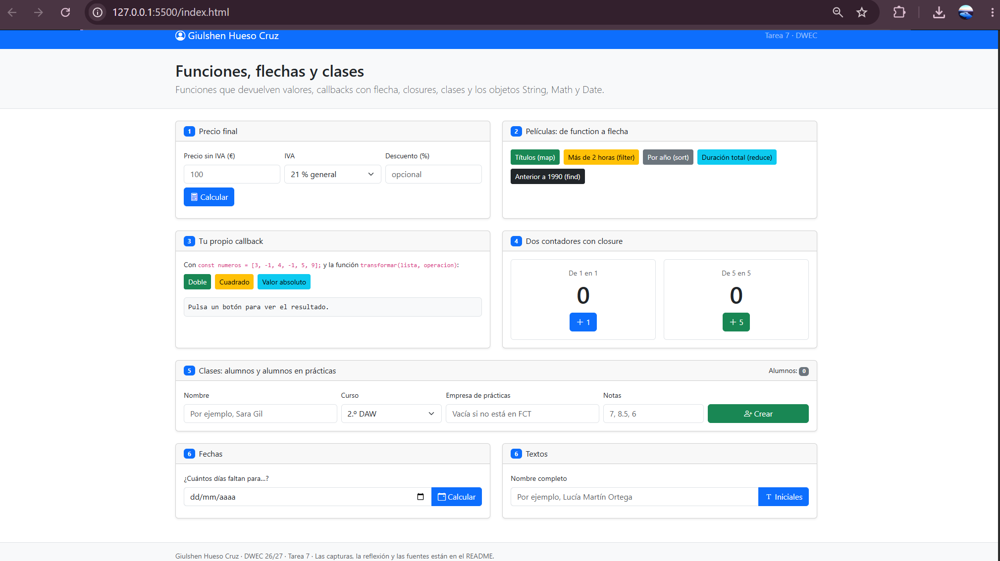
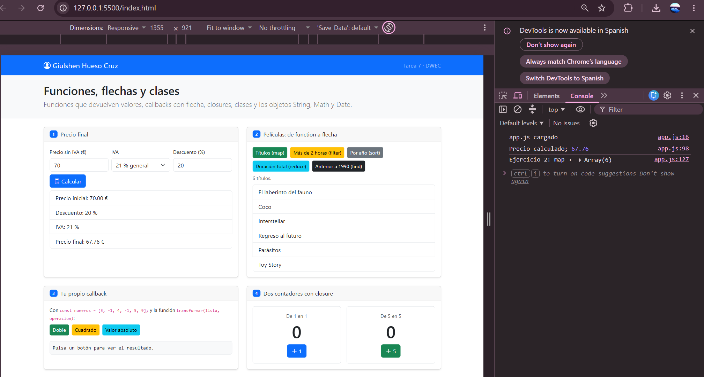
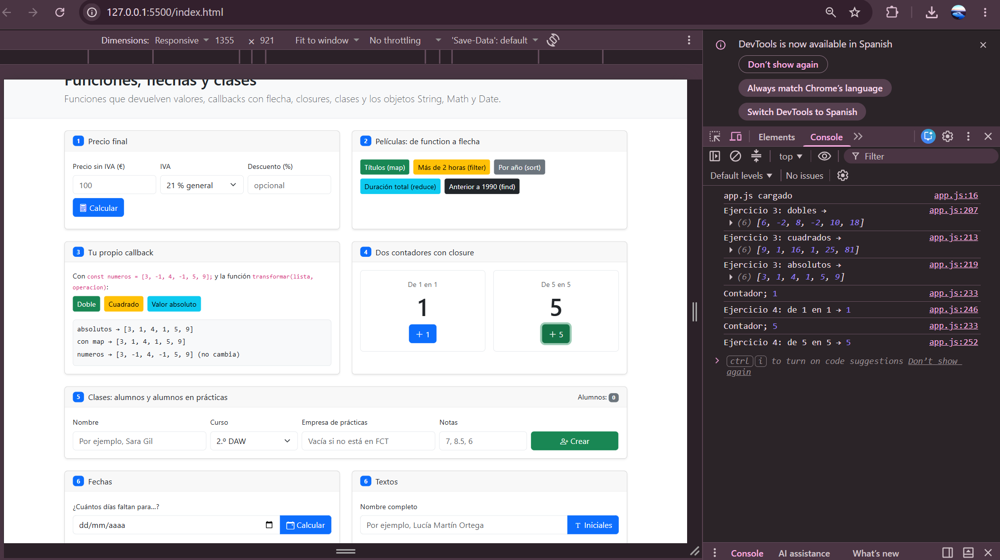
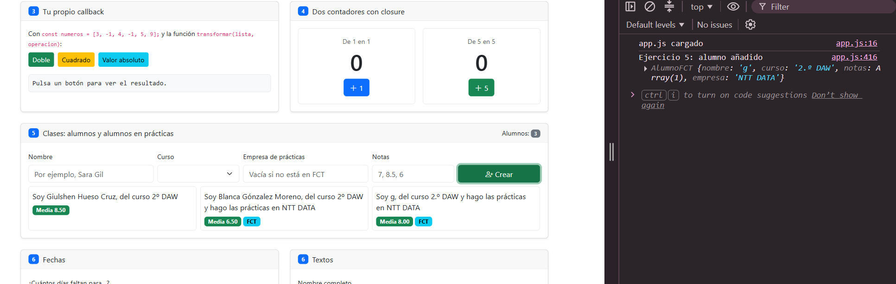
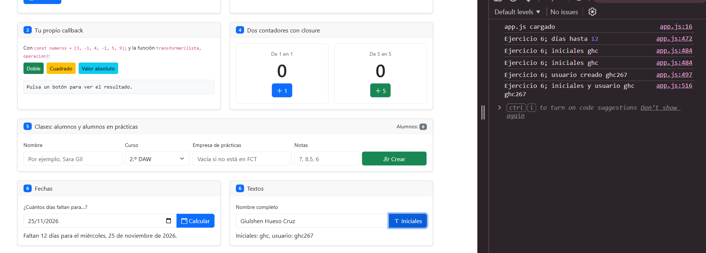

# Tarea 7 · Funciones, flechas y clases

**Autor:** Giulshen Hueso Cruz · Desarrollo Web en Entorno Cliente (DWEC) · 2.º DAW · Curso 2026-27

En esta carpeta está mi trabajo de la tarea 7, en el que he realizado seis ejercicios para practicar JavaScript. He trabajado con funciones, funciones flecha, callbacks, contadores, clases, fechas y textos. Para ver la página, solo hay que abrir el proyecto en VS Code, pulsar **Go Live** y probar los botones. También se puede abrir la consola con F12 para ver los mensajes.

## Capturas

### a) La página recién cargada

Aquí se ve cómo queda la página nada más abrirla, con mi nombre arriba y los dos alumnos que aparecen al principio en el ejercicio 5.

### b) Ejercicios 1 y 2: el precio y las películas

En el primer ejercicio he hecho una calculadora para saber el precio final de un producto, aplicando el IVA y el descuento que se elijan. En el segundo he trabajado con varias películas y he utilizado diferentes métodos para mostrar sus títulos, filtrar las que duran más de dos horas, ordenarlas por año y sumar sus duraciones.

### c) Ejercicios 3 y 4: mi callback y los contadores

En el ejercicio 3 he creado una función llamada `transformar()` que permite realizar diferentes operaciones con una lista de números. Por ejemplo, calcular sus dobles, sus cuadrados o sus valores absolutos. En el ejercicio 4 he creado dos contadores que funcionan de forma independiente: uno va sumando de uno en uno y el otro de cinco en cinco.

### d) Ejercicio 5: los alumnos

En este ejercicio he creado las clases `Alumno` y `AlumnoFCT`. La segunda hereda de la primera y permite añadir también la empresa donde se hacen las prácticas. Además, he puesto un formulario para poder añadir alumnos nuevos, sus cursos, empresas y notas, comprobando que los datos que se introducen sean correctos.

### e) Ejercicio 6: fechas y textos

En el último ejercicio he trabajado con fechas y nombres. He creado una función para calcular cuántos días faltan para una fecha o cuántos días han pasado si ya ha ocurrido. También he hecho otras funciones para sacar las iniciales de un nombre y crear un nombre de usuario con tres números aleatorios.

## Reflexión

Con esta tarea he practicado cosas nuevas de JavaScript que al principio me costaban un poco entender. He aprendido que las funciones flecha sirven para escribir algunas operaciones de una forma más corta, sobre todo cuando se utilizan métodos como `map()` o `filter()`. También he entendido que `return` sirve para devolver un resultado y poder utilizarlo después. En las clases, los métodos se escriben de otra manera y no se utilizan funciones flecha. Una de las partes que más he practicado ha sido la de las clases, porque he tenido que crear alumnos, añadir notas y calcular sus medias. Poco a poco, probando el código y corrigiendo los errores, he ido entendiendo mejor cómo funciona todo.

## Fuentes

- [MDN Web Docs – Funciones](https://developer.mozilla.org/es/docs/Web/JavaScript/Guide/Functions)
- [MDN Web Docs – Funciones flecha](https://developer.mozilla.org/es/docs/Web/JavaScript/Reference/Functions/Arrow_functions)
- [MDN Web Docs – Clases](https://developer.mozilla.org/es/docs/Web/JavaScript/Reference/Classes)
- [MDN Web Docs – Date](https://developer.mozilla.org/es/docs/Web/JavaScript/Reference/Global_Objects/Date)
- [MDN Web Docs – Math](https://developer.mozilla.org/es/docs/Web/JavaScript/Reference/Global_Objects/Math)

## Uso de IA

He utilizado ChatGPT para que me ayudara a entender algunos ejercicios y a resolver los errores que me iban saliendo mientras hacía la tarea. 
Como todavía estoy aprendiendo a programar, le he pedido que me explicara las cosas paso a paso y que me dijera qué código tenía que corregir. 
Después he ido poniendo los cambios en mi proyecto y probándolos para comprobar que funcionaban todos. 
